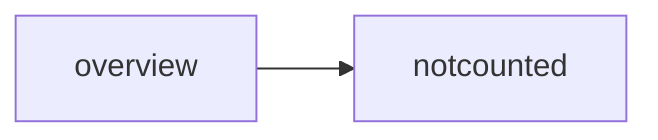
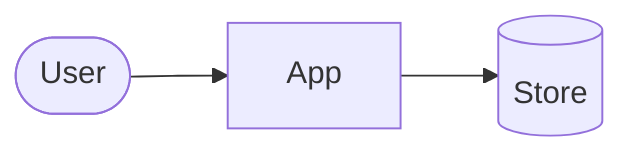
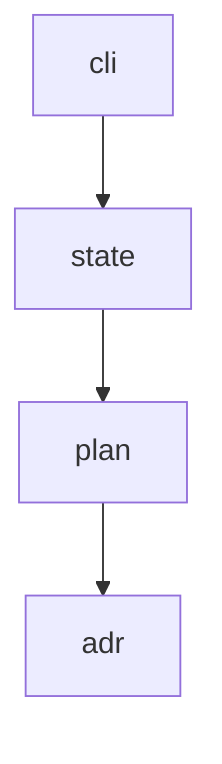
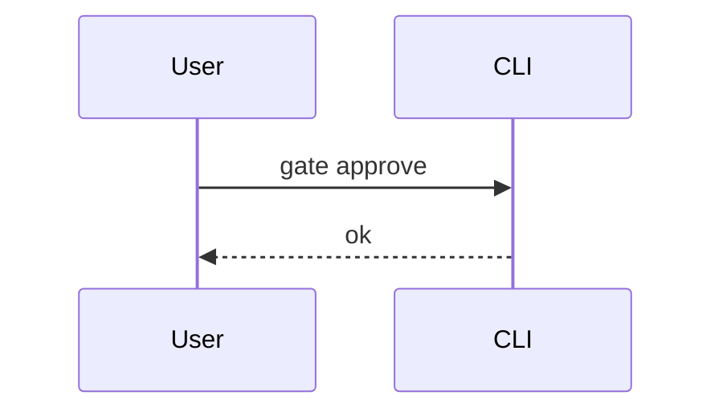
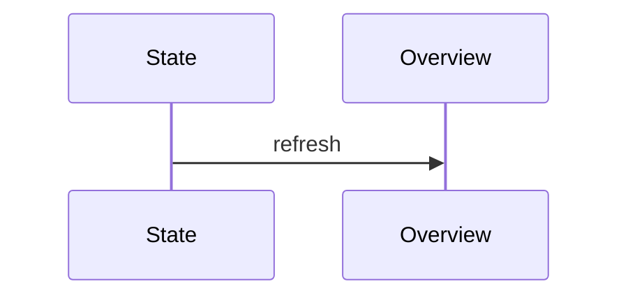
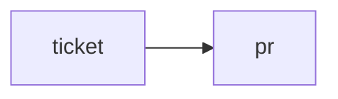

# Architecture — Synthetic fixture

- **Status:** approved
- **Date:** 2026-01-01
- **Designing for:** a hand-written fixture that mirrors the layout of a real architecture

## Overview

A short overview, with a sketch that isn't one of the diagrams:



## Diagrams

Each diagram below is a mermaid source block.

### Context

Who uses the system, and what it talks to.



### Layers

The packages, top to bottom.

```text
a plain text block before the diagram
```



### Flow: approving a gate



What happens when the check fails is described in the text below the diagram.

### Flow: regenerating the overview



### Flow: tomo PR link



## Context

Some context after the diagrams.

## Interfaces

```go
// package plan
func Load(root, change string) (*Model, error)
## not a heading, because it's inside a fence
```

## Notes

- Nothing else.
