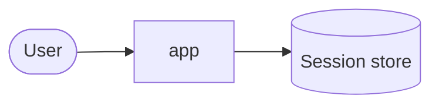
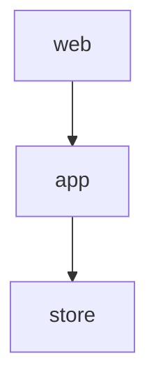
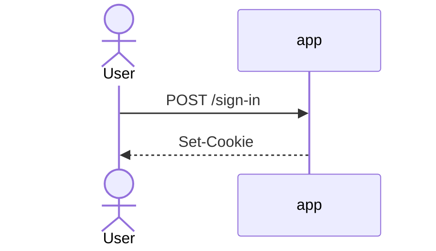
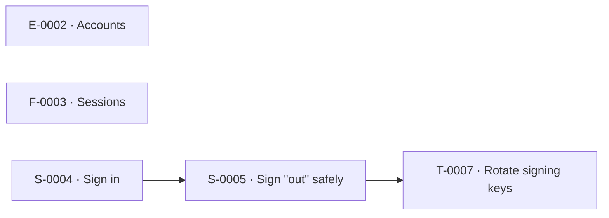
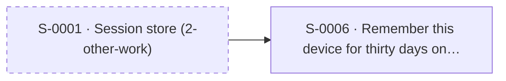

# Auth flow

<!-- zumen:narrative -->
<!-- About 250 words: the problem, the shape of the solution, who's affected, and what's out of scope. -->
<!-- /zumen:narrative -->

<!-- zumen:generated — do not edit; run `zumen overview` -->

## Status

| Phase | Status | Note |
|---|---|---|
| intake | approved |  |
| research | skipped | the team knows this area |
| explore | skipped | no repo in the intake |
| synthesis | skipped | fewer than two repos in scope |
| spec | approved |  |
| architecture | approved |  |
| breakdown | approved |  |
| publish | in-progress |  |

## Diagrams

### Context

### Layers

### Flow: sign in

From [architecture.md](architecture.md).

## Work map

- [**E-0002**](tickets/E-0002.md) Accounts · published · github o/app#0002
  - [**F-0003**](tickets/F-0003.md) Sessions · published · github o/app#0003
    - [**S-0004**](tickets/S-0004.md) Sign in · `app` · published · github o/app#0004 · R1, N1
    - [**S-0005**](tickets/S-0005.md) Sign "out" safely · `web` · ready · R2
  - [**T-0007**](tickets/T-0007.md) Rotate signing keys · `app` · draft · R2
- [**S-0006**](tickets/S-0006.md) Remember this device for thirty days on trusted browsers · `app` · draft · R3

## Dependencies

### E-0002 · Accounts

### No epic

## Repos

| Repo | draft | ready | published | Tickets |
|---|---|---|---|---|
| `app` | 2 | 0 | 1 | [S-0004](tickets/S-0004.md), [S-0006](tickets/S-0006.md), [T-0007](tickets/T-0007.md) |
| `web` | 0 | 1 | 0 | [S-0005](tickets/S-0005.md) |

## Decisions

| ADR | Title | Status | Cited by |
|---|---|---|---|
| [ADR-0001](../../04_architecture/adr/0001-use-signed-tokens.md) | Use signed tokens | accepted | [E-0002](tickets/E-0002.md), [S-0004](tickets/S-0004.md) |
| [ADR-0002](../../04_architecture/adr/0002-short-sessions.md) | Short sessions | proposed | [S-0004](tickets/S-0004.md) |
| ADR-0009 | not found |  | [T-0007](tickets/T-0007.md) |

## Traceability

From [functional-spec.md](functional-spec.md).

| Req | Priority | Covered by |
|---|---|---|
| R1 | must | [S-0004](tickets/S-0004.md) |
| R2 | must | [S-0005](tickets/S-0005.md), [T-0007](tickets/T-0007.md) |
| R3 | should | [S-0006](tickets/S-0006.md) |
| R4 | must | **uncovered** |
| N1 | must | [S-0004](tickets/S-0004.md) |

## Problems

- ! R4: must requirement in 1-auth-flow isn't cited by any ticket
- ! README: narrative is empty
- ! [T-0007](tickets/T-0007.md): cites ADR-0009, but there's no 0009-*.md ADR file

<!-- /zumen:generated -->
